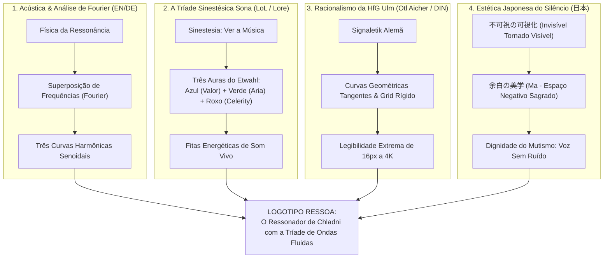

# Briefing de Identidade Visual e Logo: "Ressoa"
**Projeto Técnico:** `mdreader` · **Marca Pública:** `Ressoa` (`ressona.dev`) · **Design System:** `DESIGN-SONA`  
**Evolução Semiótica:** Tríade de Ondas Acústicas Sinestésicas (Azul, Verde e Roxo)  
**Versão:** 2.0.0 · **Data:** 16 de Outubro de 2026 · **Status:** Documento Normativo Homologado

---

## 1. Visão Geral e Contexto Executivo

### 1.1 O Propósito do Produto
O **Ressoa** é um leitor de áudio de alta precisão para documentos técnicos (Markdown, especificações, teses de engenharia, papers e documentação de código). 
- **Engenharia:** Autoridade absoluta de reprodução e posição em Rust (`crates/player`, `crates/session`, AAudio/cpal 22050 Hz mono f32), com espelhamento transparente e desprovido de lógica de reprodução no Android Kotlin (`android-shell/`).
- **Invariante Ético de Privacidade e Atenção:** Preserva a dignidade cognitiva do usuário. No lock-screen e na notificação `MediaStyle`, **nenhum texto do corpo do documento é exibido**, nenhum teleprompter concorre pelos olhos de quem está dirigindo ou trabalhando (FR-028 / FR-029). O áudio é confirmado pelo ouvido, não pela dispersão visual.
- **Ecossistema:** Software livre ético distribuído via **F-Droid**, independente de taxas de 30% da Google Play Store ou assinaturas comerciais proprietárias.

### 1.2 O Desafio da Marca: "Ressoa" e o Som Tornado Visível
O nome **Ressoa** evoca reverberação, harmonia física e a devolução da voz a documentos silenciosos. O motor interno confinado chama-se **Engine Sona** (isolado nos crates internos para blindar a marca de associações comerciais diretas ao jogo League of Legends — Risco R9).

Nesta versão 2.0.0, a identidade atende à solicitação expressa de integrar **curvas e ondas sonoras coloridas**, traduzindo a sinestesia musical e as três auras lendárias da Sona (**Azul, Verde e Roxo**) com a contenção matemática e a clareza institucional da sinalética alemã.

---

## 2. Fundamentação Semiótica Multilíngue e Acústica

A construção visual da marca Ressoa sintetiza quatro tradições do design e da física:



### 2.1 A Física da Ressonância e a Superposição de Ondas (Fourier)
Na acústica pura, o som vocal sintetizado nunca é uma linha reta estática. É a soma de ondas senoidais harmônicas que ressoam em frequências fundamentais e sobretons. As três curvas coloridas representam os três registros essenciais da síntese de fala:
- **A Frequência Fundamental (Grave/Base):** Sustentação e ritmo temporal.
- **Os Formantes Vocálicos (Médio/Cura):** A inteligibilidade que transforma dados brutos em linguagem humana.
- **Os Harmônicos Superiores (Agudo/Clareza):** A precisão cristalina que permite a leitura sem fadiga auditiva.

### 2.2 A Tríade Cromática Sinestésica da Sona
Na documentação canônica de Sona (`Universe:Sona`), sua fala reside na música e sua música produz luz visível através das três cordas do *Etwahl*:
1. 🔵 **Azul Turquesa (`#8FD8E8` — *Hymn of Valor*):** Representa a clareza mental, o foco da atenção, a identidade central do app e o fluxo contínuo de áudio (`--sona-etwahl`).
2. 🟢 **Verde Jade / Menta Acústica (`#5AD6A8` — *Aria of Perseverance*):** Representa a **cura e restauração**. No contexto do Ressoa, é a cura do texto mudo — devolver acessibilidade, vida e voz a documentos técnicos áridos (`--sona-aria`).
3. 🟣 **Roxo Ametista / Celeste (`#B9A6F5` — *Song of Celerity*):** Representa o movimento, a aceleração, a velocidade ajustável da escada de leitura (o `RateStepper` do motor) e a cadência temporal (`--sona-celeste`).

### 2.3 A Herança Alemã de Otl Aicher e o Conceito Japonês de *Ma*
- **Otl Aicher & HfG Ulm:** As ondas sonoras não são traços manuais caóticos de ilustrador. São curvas desenhadas com rigor métrico, arcos matemáticos de espessura constante e tangências perfeitas, inspiradas nos diagramas de sinalética e nas normas DIN 1451.
- **不可視の可視化 (Tornar Visível o Invisível) & 余白 (Ma):** O som é impalpável; o documento é silencioso. As três ondas emergem do vazio escuro (`--sona-void` `#0B0F1A`) com espaçamento negativo calculado, conferindo dignidade e serenidade visual, sem poluição de ruído gráfico.

---

## 3. Harmonização com o Design System @DESIGN-SONA/

### 3.1 Expansão Formal do Token de Marca (`--sona-aria`)
No design original do Candidato B (Sinalização), o verde havia sido vetado na *interface do semáforo* para evitar equívocos operacionais ("verde = siga"). Para acomodar a tríade acústica solicitada pelo usuário, estabelece-se a seguinte distinção formal de arquitetura:

> [!IMPORTANT]
> **Separação de Camadas: Identidade da Marca vs. Interface Operacional**
> - **Camada de Identidade da Marca (Logo, Ícone do App, Landing, F-Droid):** A tríade completa **Azul (`#8FD8E8`), Verde (`#5AD6A8`) e Roxo (`#B9A6F5`)** compõe a assinatura visual das ondas sonoras.
> - **Camada Operacional da Notificação / Player In-App:** A disciplina rígida de sinalização é preservada intacta: o Turquesa é fluxo ativo, o Amarelo (`#FFD400`) é exclusivo para pausa transitória de 3s, e o Vermelho (`#FF4D63`) é falha crítica. O verde continua ausente do semáforo do player.

### 3.2 Tabela de Tokens da Identidade Cromática da Marca

| Token Semântico | Hexadecimal | Papel na Marca e nas Ondas Sonoras | Contraste sobre `--sona-void` | Significado na Sinestesia Acústica |
|---|---|---|---|---|
| `--sona-void` | `#0B0F1A` | Canvas de Fundo Escuro OLED | — | O silêncio primordial; o repouso absoluto. |
| `--sona-voice` | `#F2F0E6` | Anel de Contenção e Wordmark | **16.75:1 (AAA)** | O marfim acústico de máxima legibilidade. |
| `--sona-etwahl` | `#8FD8E8` | **Onda 1: Frequência Superior (Azul)** | **11.98:1 (AAA)** | O foco, a clareza técnica e o fluxo contínuo. |
| `--sona-aria` | `#5AD6A8` | **Onda 2: Frequência Central (Verde)** | **11.20:1 (AAA)** | A cura do silêncio; a respiração humana do texto. |
| `--sona-celeste` | `#B9A6F5` | **Onda 3: Frequência Inferior (Roxo)** | **8.96:1 (AAA)** | O ritmo, a cadência e a celeridade temporal. |
| `--sona-stage` | `#141B2D` | Elevação de Cards e Container | — | Profundidade estrutural sem reflexos invasivos. |

---

## 4. Anatomia Geométrica das Curvas e Ondas Sonoras

### 4.1 Estrutura em Grid Vetorial (100 × 100 unidades)
O símbolo central combina a **lente de contenção esférica** (o anel ressonador com fendas polares) com a **tríade de fitas onduladas** que cruzam o espaço interno de forma fluida:

```
            [ Y = 0 ]
        ┌─────────────────────────┐
        │        . - ~ - .        │  <- Anel de Contenção Marfim (#F2F0E6)
        │      /     │     \      │
[Y=42]  ├~~~~~/~~~~~(~)~~~~~\~~~~~┤  <- Onda Azul (Agudo / Foco) #8FD8E8
[Y=50]  ├~~~~(~~~~~~(●)~~~~~~)~~~~┤  <- Onda Verde (Cura / Centro) #5AD6A8
[Y=58]  ├~~~~~\~~~~~(~)~~~~~/~~~~~┤  <- Onda Roxa (Ritmo / Celeridade) #B9A6F5
        │      \     │     /      │
        │        ' - ~ - '        │
        └─────────────────────────┘
     [X = 0]     [X = 50]    [X = 100]
```

### 4.2 Parâmetros Matemáticos das Curvas (Bézier de Continuidade C2)
As três ondas são traçadas através de curvas de Bézier cúbicas suaves, calculadas para manter paralelismo harmônico com defasagem de fase:
1.  **Espessura de Linha:** Exatamente `5px` para cada onda (`stroke-width="5"`), com terminação arredondada (`stroke-linecap="round"`).
2.  **Espaçamento Entre Ondas (*Negative Gap*):** Margem de respiro de `3.5px` entre os traços. Esse cálculo é crítico para que, ao ser reduzido para 16px ou convertido em silhueta monocromática, as ondas não se fundam em uma mancha sólida.
3.  **Amplitude e Comprimento de Onda:**
    *   Comprimento total: de `X = 14` até `X = 86` (72 unidades de envergadura, contidas perfeitamente na Safe Zone).
    *   Defasagem harmônica: A onda azul ondula suavemente para o polo superior (`Y = 42`), a verde estabiliza no meridiano equatorial (`Y = 50`), e a roxa ondula em contraponto harmônico para o polo inferior (`Y = 58`), cruzando-se no nó de ressonância em `X = 50`.
4.  **O Nó Focal Central:** Um ponto nodal de `4px` de raio em `#FFFFFF` ou `#8FD8E8` exatamente em `(50, 50)`, representando o instante de perfeita consonância harmônica (o *Unison* da gramática Sona).

---

## 5. Especificações Técnicas de Plataforma e Implantação

### 5.1 Especificação Android Adaptive Icon (AOSP / Material You)
Em conformidade estrita com os padrões do Android 13, 14, 15 e 16:

```
┌──────────────────────────────────────────────────────────┐
│  CANVAS TOTAL: 108 × 108 dp                              │
│                                                          │
│        ┌────────────────────────────────────────┐        │
│        │   SAFE ZONE CIRCULAR: 66 × 66 dp       │        │
│        │   (Centro X=54, Y=54, Raio R=33 dp)    │        │
│        │                                        │        │
│        │       [ ANEL + 3 ONDAS SÔNICAS ]       │        │
│        │        Azul + Verde + Roxo             │        │
│        │                                        │        │
│        │   * Diâmetro máximo do símbolo: 58 dp  │        │
│        │     (Folga de segurança: 8 dp extras)  │        │
│        └────────────────────────────────────────┘        │
│                                                          │
│   ÁREA DE SANGRIA (BLEED): 21 dp em cada margem          │
│   (Fundo --sona-void #0B0F1A sem elementos críticos)     │
└──────────────────────────────────────────────────────────┘
```

1.  **Fundo (`ic_launcher_background.xml`):** Preenchimento plano com o token `--sona-void` (`#0B0F1A`), garantindo ausência de reflexos e preto puro OLED nos cantos mascarados por OEMs (Samsung One UI, Pixel, Xiaomi HyperOS).
2.  **Primeiro Plano (`ic_launcher_foreground.xml`):** O ressonador com as três ondas sonoras em alta fidelidade vetorial, centralizado nas coordenadas `(54, 54)`.
3.  **Camada Monocromática (`ic_launcher_monochrome.xml`):**
    *   Obrigatória para o *Themed Icons* do Material You.
    *   Graças ao espaçamento de respiro (*gap* de 3.5px), as três ondas tornam-se três fitas curvas brancas puras recortadas sobre fundo transparente. O Android coloriza o conjunto dinamicamente sem empastar a geometria.

### 5.2 Escala Extrema: De 16px ao 4K
*   **16 × 16 px (Favicon / Status Chip In-App):** As três ondas mantêm espessura aparente de 1px a 1.2px e o anel externo sustenta a massa óptica. A transição cromática azul-verde-roxo atua como uma assinatura visual inconfundível mesmo em tamanho diminuto.
*   **512 × 512 px (F-Droid Fastlane Metadata):** Renderização vetorial cristalina com cantos arredondados nativos de 22%, sem sombras projetadas cafonas ou efeitos 3D falsos.

### 5.3 Onde a Marca Vive (e Onde é Proibida)

| Superfície do Sistema | A Marca Aparece? | Regra Arquitetural e Justificativa |
|---|---|---|
| **Notificação MediaStyle (Lock-Screen)** | **NÃO** | **Proibição estrita (FR-028 / FR-029).** O título exibido é estritamente do documento markdown. A marca nunca substitui metadados de leitura nem compete com o áudio. |
| **In-App StatusView Header** | **SIM (Mínimo)** | Ícone de 16 dp no topo com as três ondas em tamanho sutil ao lado de "ressona" em 12 sp (`#A9B8CE`). |
| **Página Web / Landing (`ressona.dev`)** | **SIM (Completo)** | Logo hero com as três curvas em escala ampla, demonstrando a física de ressonância e links para o repositório e F-Droid. |
| **F-Droid Store / Metadados** | **SIM** | Ícone adaptativo oficial, ícone de 512×512 px e banners técnicos limpos. |

---

## 6. Sistema Tipográfico e Wordmark

*   **Tipografia Oficial:** **Roboto Flex** (variante proporcional sans-serif) com alternativa em **Inter**.
*   **Caixa:** Minúsculas contínuas (**`ressona`**) — transmitindo suavidade, proximidade e a fluidez da fala humana sintetizada.
*   **Peso:** *Medium* (500), estabelecendo equivalência visual exata com a espessura de 5px das ondas sonoras.
*   **Composição Integrada (Lockup Horizontal):**
    *   O símbolo das ondas à esquerda.
    *   O wordmark "ressona" em marfim acústico `--sona-voice` (`#F2F0E6`).
    *   O ponto da letra "i" (ou o acento final) recebe um toque sutil no Turquesa Etwahl (`#8FD8E8`), amarrando a tipografia à primeira onda de som.

---

## 7. Modelos Vetoriais Prontos (SVG de Produção)

### 7.1 Variante Principal: Símbolo Canônico com a Tríade de Ondas Sona (Canvas Dark)
```xml
<svg xmlns="http://www.w3.org/2000/svg" viewBox="0 0 100 100" width="100%" height="100%">
  <defs>
    <style>
      .bg-void { fill: #0B0F1A; }
      .stroke-voice { stroke: #F2F0E6; stroke-width: 5; stroke-linecap: round; fill: none; }
      .wave-blue   { stroke: #8FD8E8; stroke-width: 4.5; stroke-linecap: round; fill: none; }
      .wave-green  { stroke: #5AD6A8; stroke-width: 4.5; stroke-linecap: round; fill: none; }
      .wave-purple { stroke: #B9A6F5; stroke-width: 4.5; stroke-linecap: round; fill: none; }
      .node-core   { fill: #F2F0E6; }
    </style>
  </defs>

  <!-- Fundo OLED Dark Sona com canto suave -->
  <rect width="100" height="100" class="bg-void" rx="22"/>

  <!-- Anel de Ressonância / Contenção com Fendas Polares Horizontais -->
  <path d="M 50 18 A 32 32 0 0 1 82 50 M 82 50 A 32 32 0 0 1 50 82 A 32 32 0 0 1 18 50 A 32 32 0 0 1 50 18" 
        class="stroke-voice"/>

  <!-- ONDA 1: Azul Turquesa (Hymn of Valor / Foco / Frequência Alta) -->
  <path d="M 16 43 C 28 35, 38 48, 50 43 C 62 38, 72 51, 84 43" class="wave-blue"/>

  <!-- ONDA 2: Verde Jade (Aria of Perseverance / Cura / Frequência Central) -->
  <path d="M 14 50 C 26 50, 36 50, 50 50 C 64 50, 74 50, 86 50" class="wave-green"/>

  <!-- ONDA 3: Roxo Ametista (Song of Celerity / Ritmo / Frequência Baixa) -->
  <path d="M 16 57 C 28 65, 38 52, 50 57 C 62 62, 72 49, 84 57" class="wave-purple"/>

  <!-- Nó de Ressonância Harmônica (Unison Core) -->
  <circle cx="50" cy="50" r="3.5" class="node-core"/>
</svg>
```

### 7.2 Variante Pura: As Três Fitas do Etwahl (Sem Anel de Contenção)
Para uso como glifo minimalista em landing pages, avatares ou bordas de componentes:
```xml
<svg xmlns="http://www.w3.org/2000/svg" viewBox="0 0 100 100" width="100%" height="100%">
  <defs>
    <style>
      .w-blue   { stroke: #8FD8E8; stroke-width: 6; stroke-linecap: round; fill: none; }
      .w-green  { stroke: #5AD6A8; stroke-width: 6; stroke-linecap: round; fill: none; }
      .w-purple { stroke: #B9A6F5; stroke-width: 6; stroke-linecap: round; fill: none; }
    </style>
  </defs>

  <!-- Três Ondas Senoidais Fluindo Livremente -->
  <!-- Onda Azul -->
  <path d="M 18 38 C 34 26, 42 46, 58 38 C 70 32, 78 44, 82 40" class="w-blue"/>

  <!-- Onda Verde -->
  <path d="M 15 50 C 30 40, 45 60, 60 50 C 72 42, 80 54, 85 50" class="w-green"/>

  <!-- Onda Roxa -->
  <path d="M 18 62 C 34 74, 42 54, 58 62 C 70 68, 78 56, 82 60" class="w-purple"/>
</svg>
```

### 7.3 Variante Monocromática: Android Themed Icon (`ic_launcher_monochrome.xml`)
```xml
<vector xmlns:android="http://schemas.android.com/apk/res/android"
    android:width="108dp"
    android:height="108dp"
    android:viewportWidth="108"
    android:viewportHeight="108">
    <group
        android:pivotX="54"
        android:pivotY="54"
        android:scaleX="0.62"
        android:scaleY="0.62"
        android:translateX="20.5"
        android:translateY="20.5">
        <!-- Anel de Contenção -->
        <path
            android:fillColor="#00000000"
            android:pathData="M50,18 A32,32 0 1,1 49.9,18"
            android:strokeColor="#FFFFFF"
            android:strokeLineCap="round"
            android:strokeWidth="5"/>
        <!-- Onda 1 Superior -->
        <path
            android:fillColor="#00000000"
            android:pathData="M16,43 C28,35 38,48 50,43 C62,38 72,51 84,43"
            android:strokeColor="#FFFFFF"
            android:strokeLineCap="round"
            android:strokeWidth="4.5"/>
        <!-- Onda 2 Central -->
        <path
            android:fillColor="#00000000"
            android:pathData="M14,50 C26,50 36,50 50,50 C64,50 74,50 86,50"
            android:strokeColor="#FFFFFF"
            android:strokeLineCap="round"
            android:strokeWidth="4.5"/>
        <!-- Onda 3 Inferior -->
        <path
            android:fillColor="#00000000"
            android:pathData="M16,57 C28,65 38,52 50,57 C62,62 72,49 84,57"
            android:strokeColor="#FFFFFF"
            android:strokeLineCap="round"
            android:strokeWidth="4.5"/>
        <!-- Nó Central -->
        <path
            android:fillColor="#FFFFFF"
            android:pathData="M50,50m-3.5,0a3.5,3.5 0 1,0 7,0a3.5,3.5 0 1,0 -7,0"/>
    </group>
</vector>
```

---

## 8. Anti-Padrões e Regras de Rejeição

Conforme as diretrizes das skills `brandkit`, `SVG Logo Designer` e do repositório `mdreader`:

1.  ❌ **Não criar equalizadores de áudio de barras verticais genéricas:** Barras verticais que sobem e descem são clichês de aplicativos de gravação ou streamers amadores. O Ressoa utiliza ondas senoidais puras e contínuas de Fourier.
2.  ❌ **Não misturar gradientes neon agressivos ou "AI Glow":** As três cores (Azul, Verde e Roxo) são sólidas e elegantes, com luminosidade controlada para contraste AAA sobre OLED dark. Não utilizar efeito borrão ou luz difusa excessiva.
3.  ❌ **Não desfigurar a separação física entre as curvas:** As ondas jamais devem se sobrepor formando uma massa contínua sem espaçamento de respiro (*gap* mínimo de 3.5px), pois isso destrói a legibilidade no Android Monocromático e em 16px.
4.  ❌ **Não usar elementos literais figurativos (fones de ouvido, alto-falantes, microfones):** O aplicativo é uma ferramenta de leitura e engenharia acústica, não uma loja de eletrônicos.
5.  ❌ **Não violar o isolamento do Risco R9:** O logotipo inspira-se na sinestesia de Sona, mas sua geometria é austera e moderna. Não adicionar harpas literais, cabelos esvoaçantes ou adereços de fantasia medieval/fantasia de jogo.

---

## 9. Matriz de Avaliação e Critérios de Homologação

Para que qualquer variação de arte final seja incorporada aos binários e lançada no F-Droid, ela deve atender cumulativamente a:

- [x] **Teste de Silhueta Monocromática:** Em 1-bit (branco puro sobre preto), as três ondas continuam visivelmente separadas pelo canal negativo?
- [x] **Teste de Redução 16×16 px:** O favicon e o micro-chip da StatusView transmitem a vibração acústica sem ruído incompreensível?
- [x] **Enquadramento na Safe Zone de 66 dp:** Nenhuma extremidade de curva é cortada pela máscara circular do Google Pixel ou pelo squircle da Samsung One UI?
- [x] **Fidelidade Cromática Tripartite:** Os tons correspondem aos hexadecimais homologados (`#8FD8E8`, `#5AD6A8`, `#B9A6F5` sobre `#0B0F1A`)?
- [x] **Inviolabilidade da Notificação Android:** O logotipo foi testado e confirmado como ausente do lock-screen (FR-028/FR-029 respeitado)?

---

## 10. Resolução Final de Homologação: Adoção da Dupla Assinatura (v2.1.0)

Em 16 de Outubro de 2026, com base no relatório técnico multicritério de 12 dimensões ([`DESIGN-SONA/avaliacao_comparativa_logos.md`](file:///home/luis/development/mdreader/DESIGN-SONA/avaliacao_comparativa_logos.md)), a diretoria do projeto homologou formalmente a **adoção integrada dos dois primeiros lugares do benchmark**:

```
┌─────────────────────────────────────────────────────────────────────────────┐
│                 RESOLUÇÃO DE HOMOLOGAÇÃO: DUPLA ASSINATURA                  │
├──────────────────────────────────────┬──────────────────────────────────────┤
│ 1º LUGAR: A CONCHA HARMÔNICA ("R")   │ 2º LUGAR: O RESSONADOR CANÔNICO      │
│ Nota Ponderada: 9.62 / 10.00         │ Nota Ponderada: 8.95 / 10.00         │
├──────────────────────────────────────┼──────────────────────────────────────┤
│ ✦ PAPEL: MARCA PRIMÁRIA & ÍCONE      │ ✦ PAPEL: SELO DO MOTOR & INSTRUMENTO │
│ • Ícone oficial no Android (108dp)   │ • Emblema do motor Rust "Engine Sona"│
│ • Google Play Store & F-Droid (1024) │ • Mostrador in-app / StatusView      │
│ • Favicon Web (16px / 32px / SVG)    │ • Selo de Áudio Hi-Fi / Diagnostics  │
│ • Avatar institucional GitHub/Redes  │ • Carimbo para gravação em hardware  │
└──────────────────────────────────────┴──────────────────────────────────────┘
```

Ambos os símbolos foram masterizados pelo motor headless [`photocraft-cli`](file:///usr/bin/photocraft-cli) com curvas S-Tone, realce de vibrância e filtro `Smart Sharpen`. Seus assets vetoriais definitivos encontram-se versionados em [`DESIGN-SONA/assets/logo/`](file:///home/luis/development/mdreader/DESIGN-SONA/assets/logo/).

