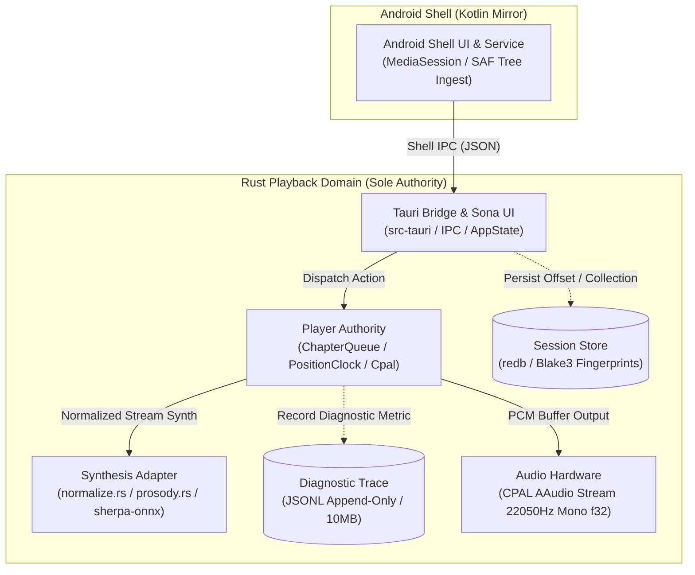

# Ressoa System Architecture

> Documento de referência arquitetural e topologia do sistema `mdreader` (produto **Ressoa**), atualizado para o **Cycle 017** (incorporando normalização, prosódia semântica, streaming de capítulos e banco redb).

---

## 1. Visão Geral da Topologia (Archify Diagram)

O diagrama arquitetural interativo standalone (com temas claro/escuro, zoom, inspeção e evidências rastreadas) foi gerado via `archify`:
- **Artefato HTML:** [.archify/architecture-ressoa-system-20261110-160117/ressoa-system.html](file:///home/luis/development/mdreader/.archify/architecture-ressoa-system-20261110-160117/ressoa-system.html)

### Diagrama Arquitetural de Componentes e Fronteiras

---

## 2. Divisão Estrita de Autoridade e Princípios de Domínio

1. **Rust é a Única Autoridade de Reprodução (`crates/player`):**
   - Controle total sobre estados de transporte (`Playing`, `Paused`, `Completed`, `Stopped`), taxa com preservação de tom (`0.75x` a `4.0x`) e buffer residente.
   - **`PositionClock` estrito:** A posição só avança conforme a entrega audível real de frames PCM pelo hardware.
2. **Android Shell é Estritamente um Espelho (`android-shell/`):**
   - Não possui lógica de contagem de tempo, progresso ou cálculo de áudio. Apenas reflete o estado publicado em JSON pelo Rust na `MediaSession` e notificações do sistema.
3. **Pipeline de Síntese Offline (`crates/adapter-synthesis`):**
   - Sanitização de sintaxe Markdown via `normalize.rs` para prevenir fadiga auditiva (tags, links e formatações não são lidos como pontuação).
   - Prosódia semântica (`prosody.rs`) baseada na árvore do documento.
   - Inferência local via `sherpa-onnx` e modelo Piper pt-BR (`22050 Hz`, mono, `f32`).
4. **Leitura Contínua de Diretórios (`specs/010-directory-reading`):**
   - `ChapterQueue` com ordenação natural de capítulos (`01-`, `02-`, `10-`).
   - Pré-roll contínuo e transição automática com gap de silêncio `< 1.0s`.
5. **Persistência e Durabilidade (`crates/session`):**
   - Armazenamento transacional em banco `redb` atrelado ao hash BLAKE3 do arquivo ou coleção de capítulos.
   - Heartbeat periódico a cada 20 segundos e retomada imediata pós-interrupção abrupta.
