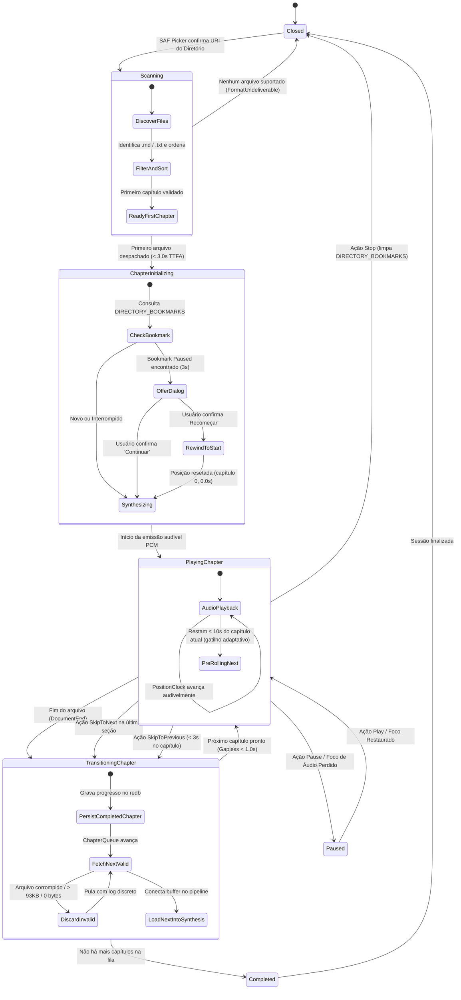

# Data Model: Leitura Contínua de Diretórios de Markdown

- **Feature**: `010-directory-reading`
- **Date**: 2026-11-03
- **Status**: Complete

## 1. Domain Entities & Value Objects

### 1.1 `DirectorySession`
Representa a sessão ativa de leitura de uma pasta/vault no Rust (`crates/player` e `AppState`).

| Campo | Tipo | Descrição |
|---|---|---|
| `tree_uri` | `String` | URI persistente SAF (`content://...`) outorgada pelo Android |
| `root_name` | `String` | Nome legível do diretório raiz selecionado (ex.: "Apostila Rust") |
| `chapters` | `Vec<ChapterItem>` | Lista ordenada dos arquivos Markdown elegíveis encontrados |
| `active_index` | `usize` | Índice do capítulo atualmente carregado/reproduzindo |
| `collection_fingerprint` | `[u8; 32]` | Hash Blake3 composto da coleção (`blake3(fp_0 || ... || fp_n)`) |
| `total_duration_estimate_secs` | `f64` | Estimativa agregada de tempo da coleção baseada em contagem de palavras |

### 1.2 `ChapterItem`
Representa um arquivo individual identificado na varredura do diretório.

| Campo | Tipo | Descrição |
|---|---|---|
| `filename` | `String` | Nome base do arquivo (ex.: `01-intro.md`) |
| `file_uri` | `String` | URI SAF individual do documento |
| `relative_path` | `String` | Caminho relativo a partir da raiz (ex.: `capitulo1/01-intro.md`) |
| `byte_size` | `u64` | Tamanho do arquivo em bytes (validado contra `MAX_DOC_BYTES = 93.636`) |
| `content_fingerprint` | `[u8; 32]` | Hash Blake3-256 do conteúdo dos bytes do documento |
| `playback_status` | `ChapterStatus` | Estado de ciclo de vida do capítulo na fila |

#### `ChapterStatus` (Closed Enum)
```rust
#[derive(Debug, Clone, Copy, PartialEq, Eq, Serialize, Deserialize)]
#[serde(rename_all = "snake_case")]
pub enum ChapterStatus {
    Pending,    // Aguardando reprodução na fila
    Playing,    // Atualmente em síntese ou áudio ativo
    Completed,  // Concluído integralmente
    Skipped,    // Pulado manualmente ou ignorado por recusa/formato inválido
}
```

### 1.3 `CompositeBookmark` & Stored Record
Entidade de persistência associada à tabela `DIRECTORY_BOOKMARKS`.

| Campo | Tipo | Descrição |
|---|---|---|
| `collection_fingerprint` | `[u8; 32]` | Chave primária: Blake3-256 da concatenação ordenada dos hashes individuais |
| `chapter_index` | `u32` | Índice ordinal do capítulo em que a reprodução parou |
| `offset_secs` | `f64` | Deslocamento salvo em segundos dentro do capítulo em questão |
| `saved_ts_ms` | `u64` | Timestamp Unix em milissegundos do momento da persistência |
| `end_kind` | `SessionEnd` | Tipo fechado de encerramento (`0=Paused, 1=Stopped, 2=Completed, 3=Interrupted`) |

---

## 2. Redb Schema Definition (`crates/session/src/store.rs`)

Para preservar 100% da integridade da tabela `BOOKMARKS` de arquivos isolados, é introduzida a nova tabela `DIRECTORY_BOOKMARKS`:

```rust
use redb::TableDefinition;

/// Tabela de marcadores para diretórios e coleções:
/// Chave: `[u8; 32]` (blake3-256 composto dos hashes ordenados da coleção)
/// Valor: `(u32, f64, u64, u8)` correspondendo a:
///   - u32: chapter_index (índice 0-based do capítulo)
///   - f64: offset_secs (posição audível no capítulo)
///   - u64: saved_ts_ms (timestamp Unix em ms)
///   - u8: end_kind_code (SessionEnd: 0=Paused, 1=Stopped, 2=Completed, 3=Interrupted)
pub const DIRECTORY_BOOKMARKS: TableDefinition<&[u8; 32], (u32, f64, u64, u8)> =
    TableDefinition::new("directory_bookmarks");
```

### Regras de Transação no Banco:
1. **Gravação**:
   - Disparada no evento de pausa deliberada, perda de foco, troca de capítulo ou encerramento do app.
   - Operação atômica em transação isolada de escrita (`db.begin_write()`).
2. **Exclusão**:
   - Acionada quando o último capítulo da pasta conclui sua leitura com sucesso (`completed`) ou quando o usuário pressiona "Stop" na Lente Sinestésica.
3. **Lookup on Open**:
   - Na abertura da pasta, recomputa-se o hash composto `collection_fingerprint`.
   - Se houver registro com `SessionEnd::Paused`: inicia no estado `AwaitOffer` emitindo `"offer_route": "in_app_dialog"`, destacando o nome do arquivo atual e o tempo salvo.
   - Se houver registro com `SessionEnd::Interrupted`: retoma imediatamente a partir do arquivo e posição salvos (`StartNow`).
   - Se não houver registro: inicia imediatamente a partir do capítulo 0 no segundo 0.0.

---

## 3. State Transitions & Lifecycle

A máquina de estados orquestra o ciclo de vida da leitura de diretórios sem intervenção do Android Shell:


